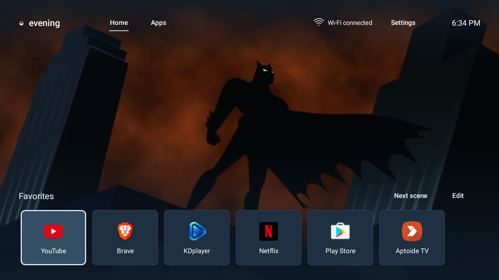

# MXQ Android TV Recovery & Evening Home

A lightweight Android TV launcher and a documented investigation of the MXQ Pro
4K / RK3229 TV box. Built for an older device that still needs a clean Home screen,
remote navigation and Android apps.



## The projects

| Project | What it contains |
|---|---|
| [Evening Home](launcher/README.md) | Native Java launcher, online backgrounds, favorites, connection status and basic music controls. |
| [Firmware & recovery research](docs/README.md) | Hardware findings, firmware comparisons, partition inventory, recovery planning and read-only diagnostic tools. |

This repository contains the standalone TV project. It does not contain an Android
OS upgrade or a verified replacement firmware image. The tested box remains on its
existing firmware; changing the launcher does not change Android compatibility.

## Evening Home

- A classic, uncluttered Home screen with real installed-app icons.
- D-pad navigation, pointer/trackpad clicks, app grid and saved favorites.
- Fresh TVMaze show/cartoon backgrounds with no account or API key.
- Daily artwork refresh, an offline cache, 15-second rotation and gentle fades.
- Bundled movie artwork, manual Next scene and a slideshow pause option.
- Wi-Fi connection indicator, clock and device-settings shortcuts.
- Recents shortcut to Android’s task switcher, with optional Accessibility setup.
- App settings access for Android’s Force stop control.
- Compact play/pause and Next controls for Android's current media receiver.

Background source, refresh and credits stay in Settings. The renderer keeps at most
two decoded frames, sampled to at most 1600 × 900. Only Internet and network-state
permissions are requested. An optional user-enabled Accessibility service opens
Recents; it requests no events or screen content. There is no notification listener
or wallpaper/playback service.

## Tested hardware and current status

The reference device is an MXQ Pro 4K / MBOX with Rockchip RK3229, ARMv7, approximately
1 GB RAM and SSV6158 Wi-Fi. Its API level and fingerprint identify **Android 7.1.2 /
API 25**, despite a higher version string in its settings.

Evening Home **0.3.0** is the last verified installation and remains selected as
default on that device. Version **0.4.0** adds the Recents
shortcut and App settings; installation and physical task-dismissal tests are pending
because the device refused its ADB connection. Native
D-pad operation was owner-confirmed; eight TVMaze backgrounds were fetched and a
downloaded background was observed on Home. The original system launcher is retained.

Spotify TV 1.81.55 and Audiomack 6.59.1 were separately installed and opened during
the investigation. Their APKs are not included. Audiomack exposes a standard
Android launch activity and may require pointer navigation. Real music playback
and launcher transport controls still need a player test.

For 0.4.0, select **Recents → Accessibility settings → Evening Home — Recents → On**
once, return Home, then select **Recents** again. Android provides task removal.
For services that keep running, use **Settings → App settings → app → Force stop**.
See [Recent apps](docs/recent-apps.md) for behavior and firmware limits.

See [verification and remaining limits](launcher/VERIFICATION.md) and the
[music app installation record](docs/music-app-installation.md). Other MXQ units
can use different boards and wireless chips; this device's findings are not proof
of firmware compatibility for another unit.

## Build and test the launcher

Requirements: Python 3.9+, JDK 17, Android SDK platform `android-35` and build-tools
`35.0.0`.

```bash
git clone https://github.com/Dom000/mxq-android-tv-recovery.git
cd mxq-android-tv-recovery

# Set these to your local SDK and JDK installations.
export ANDROID_SDK_ROOT=/path/to/Android/sdk
export JAVA_HOME=/path/to/jdk-17

bash launcher/build.sh
bash launcher/tests/check.sh
```

The build uses official SDK tools directly: `javac`, D8, `aapt`, `zipalign`
and `apksigner`. It needs no Gradle or third-party Android libraries.
Output: `launcher/build/EveningHome-preview.apk` plus checksum and verification
metadata. Build output is intentionally untracked.

The first build generates a local preview signing key under `launcher/.keys/`.
Keep it private and preserve it for your own upgrades. A locally generated key
cannot update an installation signed by a different key.

Build scripts do not install anything. Fresh APKs ship the Home handler disabled;
installation alone does not replace the existing default launcher. Read the
[installation and rollback record](launcher/INSTALL.md) before device changes.

## Browser preview

Open [launcher/preview/index.html](launcher/preview/index.html) locally. Arrow keys
move focus, Enter activates and Escape returns Home. The preview starts with
bundled art; Settings can fetch TVMaze backgrounds.

The browser cannot launch Android apps. Wi-Fi and music controls are explicitly
simulated. The native APK discovers the device's installed apps through Android.
Optional Playwright checks are documented in the [launcher README](launcher/README.md).

## Hardware and firmware research

Start with the [research guide](docs/README.md), especially the
[hardware profile](docs/hardware-profile.md),
[firmware candidates](docs/firmware-candidates.md) and
[recovery plan](docs/recovery-plan.md).

The scripts in `scripts/` perform bounded, read-only diagnostics against a fixed
ADB target and verify RK3229 identity. They never choose an arbitrary device,
target an emulator, scan the LAN or flash partitions. Before using them, review
the `TV` constant in [scripts/diagnose.py](scripts/diagnose.py) and confirm that it
identifies your own device. Some collectors use existing root access for reads.

```bash
bash scripts/check-connection.sh
bash scripts/collect-hardware.sh
bash scripts/inspect-partitions.sh
```

No firmware backup or verified independent recovery path was completed. The
documented recommendation is to retain the current firmware. Armbian and
LibreELEC were investigated but do not satisfy the requirement to run Android APKs.

## Repository layout

```text
launcher/    Native app, resources, browser preview, build tools and tests
docs/        Hardware, firmware, recovery and app-compatibility investigation
scripts/     Read-only ADB collectors and an offline backup verifier
research/    Public source references, checksums and structured research evidence
```

Private diagnostics, device-tree dumps, backups, downloaded APKs, build output,
signing keys and credentials are excluded by `.gitignore`.

## Artwork and credits

Online background data comes from [TVMaze](https://www.tvmaze.com/api), with its
CC BY-SA attribution retained in the cache and linked from Settings/About.
Bundled studio images, app icons and other artwork retain their owners' rights;
see [wallpaper sources](launcher/WALLPAPERS.md) and the included asset catalogues.
No third-party app, firmware binary or signing key is distributed here.
